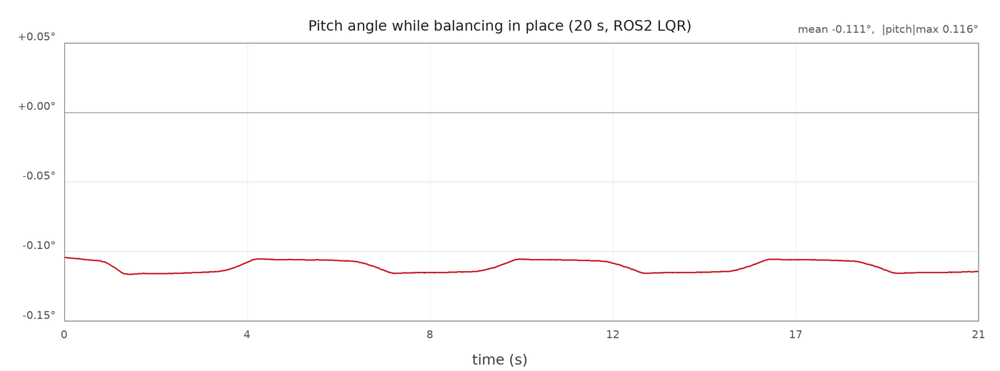

# wheel_leg_controller

轮腿机器人**控制器节点**（ROS 2 / ament_python）。包内只有控制律与 ROS 2 接口，
**不包含 MuJoCo**（可用 `grep -rn mujoco .` 验证为空）：仿真、被控对象全部在独立的
`wheel_leg_sim` 包中，两个节点各自 `ros2 run` 启动，只通过话题通信。

## 1. 包结构

```
wheel_leg_controller/
├── package.xml / setup.py / setup.cfg
├── doc/pitch_standstill.png          # 实测 pitch 曲线（由 bag 回放提取）
├── record/wheel_leg_bag/             # 20.7 s 的 /imu /joint_states /actuator_cmd bag
└── wheel_leg_controller/
    ├── controller_node.py            # 节点：接口 + 控制回路编排（本作业重写部分）
    ├── vmc_cal.py                    # 五连杆 VMC 正运动学 / 雅可比（复用）
    ├── lqr_update.py                 # LQR 状态更新 + K 多项式（复用）
    ├── roll_leg_control.py           # 横滚差模腿长分配（复用）
    └── ground_detection.py           # 触地检测（复用，默认关闭）
```

`vmc_cal / lqr_update / roll_leg_control / ground_detection` 直接取自
`training/02-ros2-wheelleg/Wheel_Leg/LQR_VMC/`，未做算法改动；
`robot_control_main.py` 的主循环没有搬过来，本节点只把「ROS 2 接口 + 一条控制周期的编排」重写。

## 2. 接口

| 方向 | 话题 | 类型 | 内容 |
|---|---|---|---|
| 仿真 → 控制器 | `/imu` | `sensor_msgs/msg/Imu` | 机体姿态四元数、角速度 |
| 仿真 → 控制器 | `/joint_states` | `sensor_msgs/msg/JointState` | 6 关节角/角速度，顺序 right1,right2,left1,left2,rightwheel,leftwheel |
| 外部 → 控制器 | `/cmd_vel` | `geometry_msgs/msg/Twist` | `linear.x` → LQR 的 `v_set`；`angular.z` → 目标偏航角速度 |
| 控制器 → 仿真 | `/actuator_cmd` | `rm_msgs/msg/WheelLegCmd` | 六路力矩 r1,r2,l1,l2,rightwheel,leftwheel |

节点**不设固定频率定时器**：仿真节点是"一条 `/actuator_cmd` 走一个 `dt=0.002 s`"，
所以本节点把每条 `/joint_states` 当作控制周期时钟——收到状态→解算→立刻发一条力矩，
严格做到一条状态对应一步仿真，控制器里的 `dt` 恒等于模型 `dt`。

## 3. 控制结构

```
 /cmd_vel ──► 限幅 ±0.3 ──► 斜坡 0.8/1.4 m/s² ──► current_v (v_set)
                                                    │
 /imu ───────────────► φ, φ̇ (pitch)                 ├──► x_ref += v_set·dt
                                                    │        │
 /joint_states ──► VMC 五连杆 FK ──► L_0, θ, θ̇      │        ▼
                          │                         │    x_err = clip(x_b − x_ref, ±0.5)
                          ├──► 腿长 PID(700/0/5) ──► F_0 = 4/cosθ + PID
                          │
                          └──► K(L_0)（12 维，三次多项式在线插值）
                                     │
                    ┌────────────────┴─────────────────┐
                    ▼                                  ▼
   T_p = K1θ+K3θ̇+K5x_err+K7(v_b−v_set)+K9φ+K11φ̇     wheel_t = ±[K0θ+K2θ̇+K4x_err
                                                    +K6(v_b−v_set)+K8φ+K10φ̇] − yaw
                    └──────────► VMC 雅可比 ──────────┘
                                     ▼
                    四个髋关节力矩 + 两个轮力矩 → /actuator_cmd
```

- **两条腿各自独立解算**（`leg_flag=0` 右 / `1` 左），左右轮安装方向相反用 `sign` 处理。
- **腿长环**：`F_0 = 4/cosθ`（重力前馈，质量约 3.86 kg、目标腿长 0.10 m）+ 腿长 PID(700, 0, 5)。
- **LQR 环**：12 维状态 → 虚拟劈叉力矩 `T_p` 与轮力矩 `wheel_t`，再经 VMC 雅可比分配到髋关节。
- **速度通道（阶段 5）**：`/cmd_vel.linear.x` 直接写入 `v_set`；同时对 `x_ref` 积分，
  用 LQR 原生的 `K4/K5` 位移通道做速度外环。没有额外引入自造增益。
- **保护**：
  - `v_cmd_limit=0.3`：指令限幅。实测超过 0.3 m/s 会把腿角顶到机械限位并失稳。
  - `warmup_steps=2500`（5 s 仿真时间）：启动下落瞬态期间只做平衡，不响应行驶指令。
  - `tilt_limit=0.12 rad`：俯仰过大时冻结位移参考，避免"带病行驶"。
  - `x_err_limit=0.5 / x_err_breakaway=0.9`：位移误差限幅；有指令但轮子几乎不转（卡死）时放宽到 0.9 把机体"拔"出死区。
  - `max_wheel_torque=1.9`（执行器上限 2.0，留余量）。

### 模式

| `mode` | 用途 |
|---|---|
| `openloop` | 固定/正弦力矩，打通链路（阶段 1） |
| `wheel_pi` | 只做轮速 PI 跟踪（阶段 2） |
| `vmc` | 只做腿长 VMC 闭环（阶段 3） |
| `lqr` | 全闭环：LQR 平衡 + VMC 腿长 + `/cmd_vel` 行驶（阶段 4/5） |

## 4. K 与参数来源

| 项 | 来源 |
|---|---|
| `K[0..11]` | `lqr_update.py` 的 `POLY_COEFFICIENT`（12×4）。MATLAB 对 `robot.xml` 线性化整定的 LQR 增益，再按虚拟腿长 `L_0` 拟合成三次多项式，运行时用 Horner 法在线插值；腿长变化时 K 连续变化，无需切换表 |
| 五连杆几何 / VMC 雅可比 | `vmc_cal.py`，几何参数取自 `robot.xml`（腿有效行程约 0.09–0.17 m） |
| 腿长 PID | 700 / 0 / 5，沿用参考实现 |
| 偏航 PID | 0.5 / 0 / 1（作用在 `gyro_yaw` 上，输出并入轮力矩） |
| 轮速 PI（阶段 2） | `kp=0.20, ki=0.80`、积分限幅 2.0，本作业整定 |
| 速度斜坡 / 限幅 | `accel_rate=0.8`、`decel_rate=1.4`、`v_cmd_limit=0.3`，本作业实测整定 |
| 其它保护参数 | `warmup_steps / tilt_limit / x_err_limit / x_err_breakaway / max_wheel_torque`，本作业实测整定 |

所有参数都用 `declare_parameter` 暴露，可命令行覆盖，例如
`--ros-args -p mode:=lqr -p target_length:=0.11 -p v_cmd_limit:=0.25`。

## 5. 实测结果

测试平台：`robot.xml`（总质量约 3.86 kg，轮半径 0.06 m，仿真 `dt=0.002 s`），
`wheel_leg_sim` + 本节点，`realtime:=true, rtf:=1.0`。

### 5.1 原地平衡（bag 数据，20.7 s）



| 指标 | 数值 |
|---|---|
| 采样 | 10253 帧 `/imu`（500 Hz） |
| 时长 | 20.72 s |
| pitch 均值 | −0.111° |
| pitch 标准差 | 0.004° |
| \|pitch\| 最大 | 0.116° |
| 腿长 L_0 | 0.099 m（目标 0.10，误差 −1 mm） |
| 轮力矩 | 约 ±0.01 N·m（几乎不出力） |

验收标准为"原地平衡 > 5 s、pitch 偏差 < 10°"，实测 20.7 s 内偏差 < 0.12°。
另有长时运行：同一组节点连续站立 **832 s（约 13.9 min）仿真时间**（步数 52 000→468 000）
未跌倒，pitch 始终在 ±0.12° 内。

### 5.2 行驶（`/cmd_vel` → `v_set`）

| 指令 | 实测 `v_meas` | pitch | 结论 |
|---|---|---|---|
| `linear.x = −0.20` | −0.200 m/s | +0.009 rad | 误差 0%，连续 40 s 稳定 |
| `linear.x = +0.30` | +0.300 ± 0.027 m/s | −0.019 rad | 误差 < 2%，连续 60 s 稳定 |
| `linear.x = 0` | −0.000 m/s | −0.002 rad | 回到原地平衡 |

注意：`obstacles.xml` 在 x=1/2/3/4/5 m 处各有一块斜坡挡板，从原点**前进约 1 m**
就会撞上——轮子被挡住空转、轮里程不再增长，而 `x_ref` 仍在积分，`x_err` 会打满限幅
导致振荡。这是场景障碍导致的，不是控制律问题（同一控制器向后空旷方向行驶完全正常）。
演示前进请先把机器人挪到远离斜坡的位置，或临时注释 `robot.xml` 里的
`<include file="obstacles.xml"/>`。

## 6. 构建与运行

```bash
source ~/ros2_ws/activate.sh
cd ~/ros2_ws && colcon build --packages-select wheel_leg_controller --symlink-install

# 终端 A：仿真（带查看器；加 -p viewer:=false 关闭）
ros2 run wheel_leg_sim wheel_leg_sim --ros-args -p viewer:=true

# 终端 B：控制器（必须写 --ros-args，否则 -p 会被当成 remap 规则）
ros2 run wheel_leg_controller wheel_leg_controller --ros-args -p mode:=lqr

# 终端 C：行驶指令（限幅 ±0.3，超了也只跑 0.3）
ros2 topic pub -r 10 /cmd_vel geometry_msgs/msg/Twist "{linear: {x: -0.2}}"
```

同一时刻只能有一套仿真 + 控制器，重复启动会同时向 `/actuator_cmd` 发指令而失稳。

## 7. 录包

`record/wheel_leg_bag/` 是 20.7 s 的原始数据，用实时模式录制（实测实时率 1.000×）：

```bash
ros2 run wheel_leg_sim wheel_leg_sim --ros-args -p viewer:=false -p realtime:=true -p rtf:=1.0
ros2 run wheel_leg_controller wheel_leg_controller --ros-args -p mode:=lqr
ros2 bag record -o record/wheel_leg_bag /imu /joint_states /actuator_cmd
```

```
Topic: /actuator_cmd | Type: rm_msgs/msg/WheelLegCmd  | Count: 9852
Topic: /joint_states | Type: sensor_msgs/msg/JointState | Count: 10253
Topic: /imu          | Type: sensor_msgs/msg/Imu       | Count: 10253
Duration: 20.72 s
```

回放：`ros2 bag play record/wheel_leg_bag`；`doc/pitch_standstill.png` 就是该 bag 中
`/imu` 四元数解算出的 pitch 曲线。
